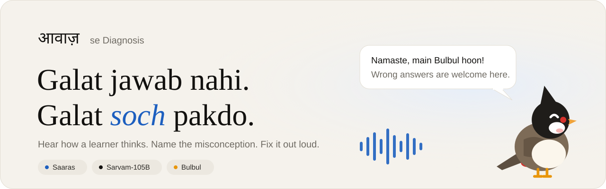
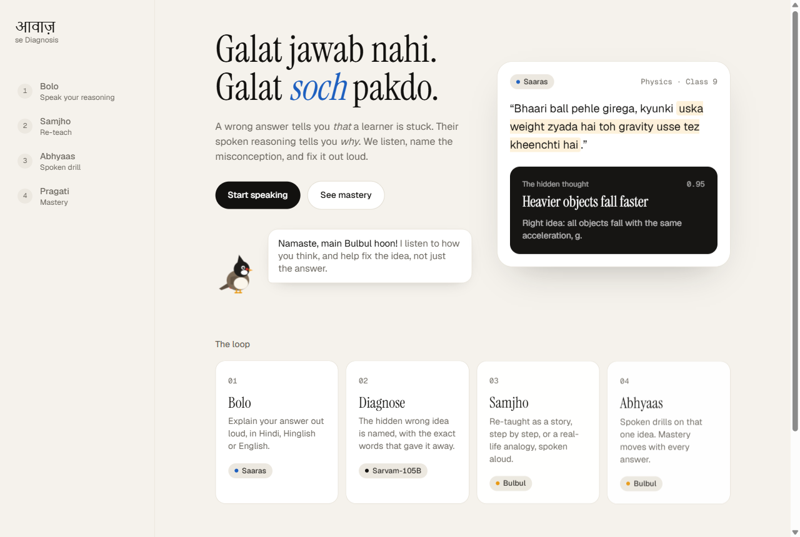
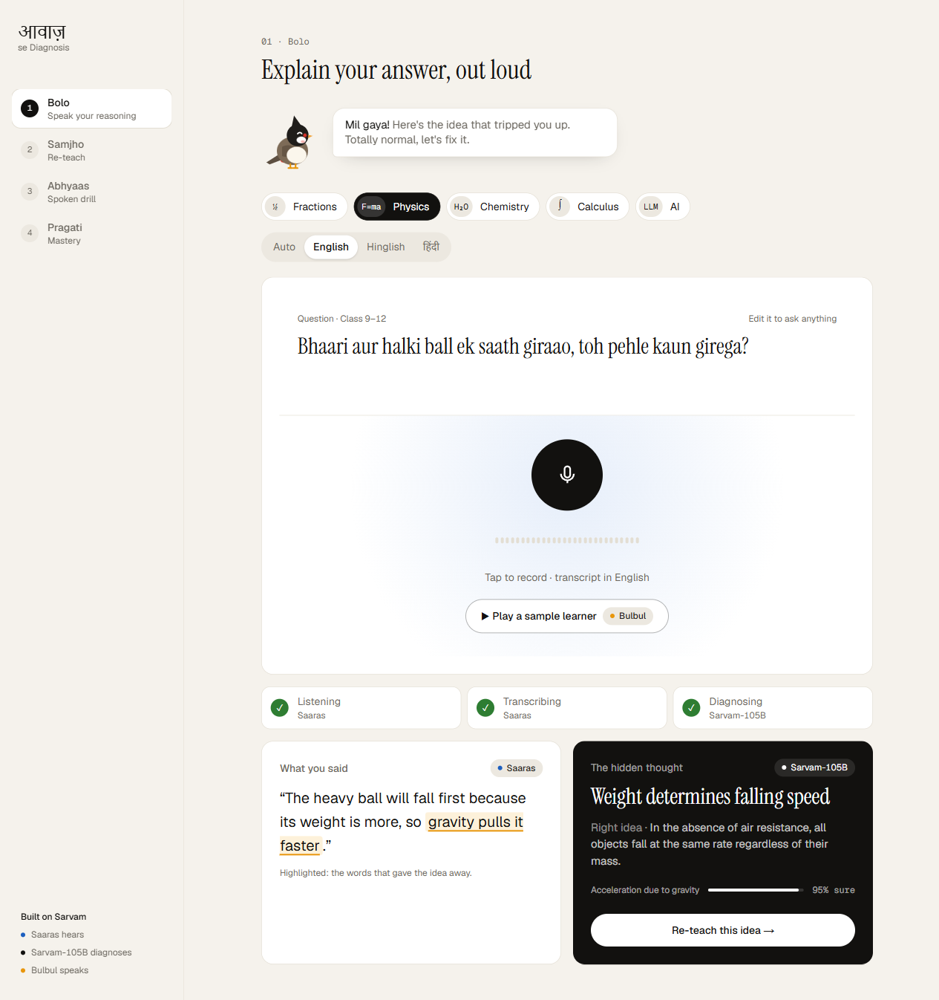
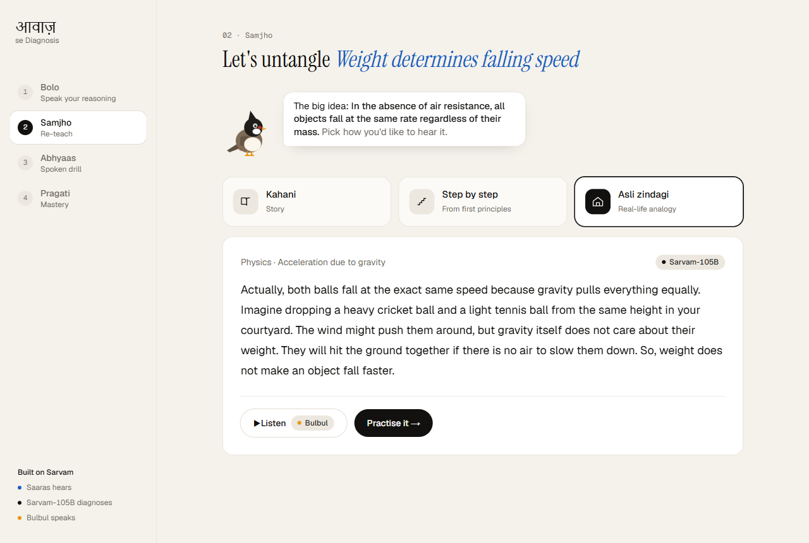
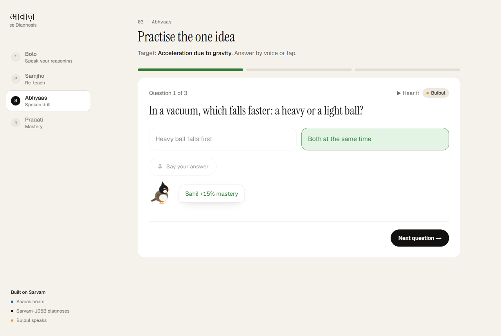
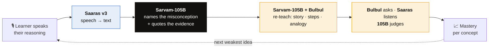
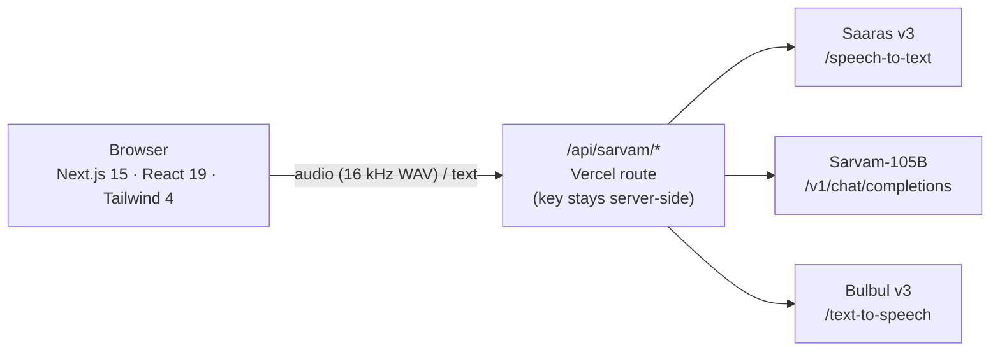

<p align="center">
  
</p>

<p align="center">
  <a href="https://web-blush-gamma-25.vercel.app"></a>
  
  
  
</p>

<p align="center">
  
  
  
  
  
</p>

<h3 align="center">A wrong answer tells you <i>that</i> a learner is stuck.<br/>Their spoken reasoning tells you <i>why</i>.</h3>

<p align="center">
Learners explain an answer out loud, in Hindi, Hinglish or English.<br/>
<b>Aawaz se Diagnosis</b> hears the reasoning, names the misconception behind it,<br/>re-teaches that one idea a new way, and drills it by voice.
</p>

---

## ✨ See it in action

<table>
  <tr>
    <td width="50%"><p align="center"><b>Home</b>: meet Bulbul, your guide</p></td>
    <td width="50%"><p align="center"><b>Bolo</b>: speak, get the hidden thought</p></td>
  </tr>
  <tr>
    <td width="50%"><p align="center"><b>Samjho</b>: re-taught three ways, read aloud</p></td>
    <td width="50%"><p align="center"><b>Abhyaas</b>: targeted drills, by voice or tap</p></td>
  </tr>
</table>

---

## 🔁 The loop: three Sarvam models, one conversation



| Step | Screen | What happens | Sarvam model |
|:---:|---|---|---|
| **01** | **Bolo** · speak | Pick a topic (or type any question) and explain your answer out loud | 🔵 **Saaras v3** |
| **02** | Diagnose | Names the *wrong mental model*, highlights the exact words that revealed it, states the right idea and a confidence score | ⚫ **Sarvam-105B** |
| **03** | **Samjho** · re-teach | *Kahani* (story), *Step by step*, or *Asli zindagi* (real-life analogy). Bulbul first echoes back what you said, then explains | ⚫ **105B** + 🟠 **Bulbul v3** |
| **04** | **Abhyaas** · drill | Questions aimed at that one misconception. Hear them, answer by voice or tap | 🟠 **Bulbul** · 🔵 **Saaras** · ⚫ **105B** |
| **05** | **Pragati** · mastery | Progress rings per concept, weakest first. +15% for right, −5% for wrong | |

---

## 🌟 What makes it different

- **🧠 Diagnoses the *thinking*, not the answer.** "1/3 is bigger because 3 > 2" and a lucky guess look the same on paper. Spoken, they don't.
- **🔍 Shows its evidence.** Every diagnosis highlights the exact phrase that gave the misconception away, so a teacher can check it at a glance.
- **🗣️ Speak the way you think.** Hindi, Hinglish or English. Choose how the transcript appears: **Auto** (keeps your language), **English**, **Hinglish** (Roman script) or **हिंदी**.
- **🐦 A friendly guide.** Bulbul (a red-whiskered bulbul, named after Sarvam's voice model) listens, thinks, cheers and says *"wrong answers are welcome here."*
- **🔁 Echo-back re-teaching.** *"Tumne kaha… chalo naye tareeke se samajhte hain."* The explanation starts from the learner's own words.
- **📚 Class 5 to college.** Fractions, physics, chemistry, calculus, even how LLMs work. The question box is editable, so any subject works.

---

## 🧪 Try it yourself

Open the **[live app](https://web-blush-gamma-25.vercel.app)** → **Bolo** → pick a topic → **Play a sample learner**, or edit the question and **record** one of these wrong explanations:

<details open>
<summary><b>⚛️ Physics</b></summary>

| Question | Say this (the wrong idea) | Misconception it should catch |
|---|---|---|
| Bhaari aur halki ball, pehle kaun girega? | *"Bhaari ball pehle girega, uska weight zyada hai"* | Heavier objects fall faster |
| Dhakka dene ke baad ball kyun ruk jaati hai? | *"Ball ki force khatam ho jaati hai"* | Motion needs a continuous force |
| Bulb mein current ka kya hota hai? | *"Bulb current kha jaata hai"* | Current gets used up |
| Garmi ka mausam kyun aata hai? | *"Dharti sooraj ke paas aa jaati hai"* | Seasons come from distance, not tilt |
| Space mein astronaut kyun tairte hain? | *"Space mein gravity hoti hi nahi"* | No gravity in orbit (it's free fall) |

</details>

<details>
<summary><b>🧪 Chemistry</b></summary>

| Question | Say this (the wrong idea) | Misconception it should catch |
|---|---|---|
| Ubalte paani ke bubbles mein kya hai? | *"Oxygen aur hydrogen alag ho jaate hain"* | Boiling splits water (bubbles are steam) |
| Cheeni paani mein kahan jaati hai? | *"Cheeni gayab ho jaati hai"* | Dissolving destroys matter |
| Lakdi jalne ke baad raakh halki kyun hai? | *"Matter khatam ho jaata hai"* | Mass is lost in burning |
| Strong acid ka pH kaisa hota hai? | *"Strong acid ka pH zyada hota hai"* | Higher pH means stronger acid |

</details>

<details>
<summary><b>➗ Maths</b></summary>

| Question | Say this (the wrong idea) | Misconception it should catch |
|---|---|---|
| 1/3 aur 1/2 mein bada kaun? | *"1/3 bada hai kyunki 3 bada hai 2 se"* | Bigger denominator means bigger fraction |
| 1/2 + 1/3 kitna hota hai? | *"Upar upar jodo, neeche neeche: 2/5"* | Adds numerators and denominators |
| 0.25 aur 0.5 mein bada kaun? | *"0.25, kyunki 25 bada hai 5 se"* | Decimals read as whole numbers |
| x² ka derivative? | *"Bas power hata do, toh x"* | Drops the power-rule coefficient |
| Coin par 5 baar head aaya, ab? | *"Ab tail pakka aayega"* | Gambler's fallacy |

</details>

> 💡 Try a **correct** explanation too. Bulbul should say *"Wah! Your reasoning is solid"* rather than invent a mistake.

---

## 🏗️ How it's built



- **Frontend:** Next.js 15 (App Router), React 19, Tailwind CSS 4, deployed on **Vercel**.
- **Sarvam proxy:** [`web/src/app/api/sarvam/[...path]/route.ts`](web/src/app/api/sarvam/%5B...path%5D/route.ts) is an allow-listed route, so `SARVAM_API_KEY` never reaches the browser.
- **Audio:** browsers record webm/opus, which Saaras rejects, so [`recorder.ts`](web/src/lib/recorder.ts) re-encodes to 16 kHz mono WAV in the browser. It also drives the live mic waveform.
- **Prompts and language logic:** [`web/src/lib/sarvam.ts`](web/src/lib/sarvam.ts).
- **Design:** paper ground, ink chrome, one blue for Saaras and data, marigold for the "wrong thought". Instrument Serif + Geist + Noto Sans Devanagari.
- **`api/`:** a FastAPI + SQLite mastery API for Render (written, not yet deployed).

---

## 🚀 Run locally

```bash
git clone https://github.com/Niranjan-cyber/aawaz-se-diagnosis.git
cd aawaz-se-diagnosis/web
echo "SARVAM_API_KEY=your_key_here" > .env.local   # get one at dashboard.sarvam.ai
npm install
npm run dev                                        # http://localhost:3000
```

Allow microphone access when the browser asks. No mic? Use **Play a sample learner**.

---

## 🧭 Honest limits (prototype)

| | Today | Next |
|---|---|---|
| 📈 Mastery | Saved in the browser (per device) | Server-side per student (the `api/` service on Render) |
| 👩‍🏫 Teachers | Learner view only | Class dashboard grouped by misconception |
| 🌐 Languages | Hindi · Hinglish · English | All of Sarvam's Indian languages |
| 🎯 Diagnosis | One 105B call, shows confidence and evidence | Second-pass check and teacher review |
| 🔐 Access | Open demo, no accounts | Auth and rate limiting on the Sarvam proxy |

---

## 🗺️ Roadmap

- [ ] Teacher dashboard: see which wrong idea half the class shares
- [ ] Spaced re-drills of the weakest concept
- [ ] WhatsApp voice-note input for low-device classrooms
- [ ] Every Sarvam-supported Indian language
- [ ] Persisted student profiles on Render

---

<p align="center">
  Built with 💙 on <b>Sarvam AI</b>: <b>Saaras</b> hears · <b>Sarvam-105B</b> diagnoses · <b>Bulbul</b> speaks
  <br/><br/>
  <a href="https://web-blush-gamma-25.vercel.app"><b>Try the live demo →</b></a>
</p>
